# 1 Motivation

Footwear examination is important to forensic investigation. The features provided by footwear prints are known as class characteristics (\@fig-classes): they may be shared by many shoes of the same make and model, but are useful for narrowing down a subject pool and providing some association between a suspect and the scene [@bodziak2017footwear]. Collection and processing of footwear data require large amounts of human labor, hence, automating the the process of identification class characteristics is essential. With advances in neural network-based vision models, automated process has become feasible.

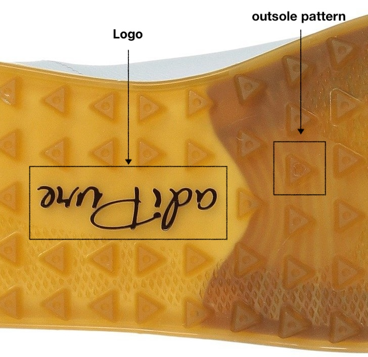{#fig-classes fig-align="center" width="200"}

<!-- 2. Literature Review -->

<!-- 2.1 Neural Network-Based Vision Models -->

<!--     2.1.1 Convolutional Neural Networks -->

<!--     2.1.2 Vision Transformers -->

<!--     2.1.3 Visual Backbones and Feature Representation -->

<!-- 2.2 Image Classification -->

<!--     2.2.1 Data Structure for Classification -->

<!--     2.2.2 Common Backbone Architectures -->

<!--            VGG, ResNet, Vision Transformer -->

<!--     2.2.3 Transfer Learning in Vision Models -->

<!-- 2.3 Object Detection -->

<!--     2.3.1 Difference Between Classification and Object Detection -->

<!--     2.3.2 Data Structure for Object Detection -->

<!--     2.3.3 Backbone and Detection Head -->

<!--     2.3.4 One-Stage and Two-Stage Detectors -->

<!-- 2.4 Faster R-CNN -->

<!--     2.4.1 Region Proposal Network -->

<!--     2.4.2 Proposal Classification and Bounding Box Regression -->

<!--     2.4.3 Advantages of the Proposal-and-Refinement Framework -->

<!--     2.4.4 Relevance to the Present Study -->

# 2 Neural Network Vision Models

Modern neural network-based vision models are mainly built on two categories of architectures: convolutional neural networks and attention-based networks. Although they use different mechanisms, these architectures are used as backbones to extract features from images. These features can be used by downstream task-specific modules, which are also referred to as heads. Task-specific heads are selected depending on the objective of the model. For example, in an image classification task, a classification head is attached to the backbone to predict image-level categories. In an object detection task, detection heads are used to predict both object classes and bounding box locations. A diagram of a neural network is shown in @fig-1-vision-model-diagram.

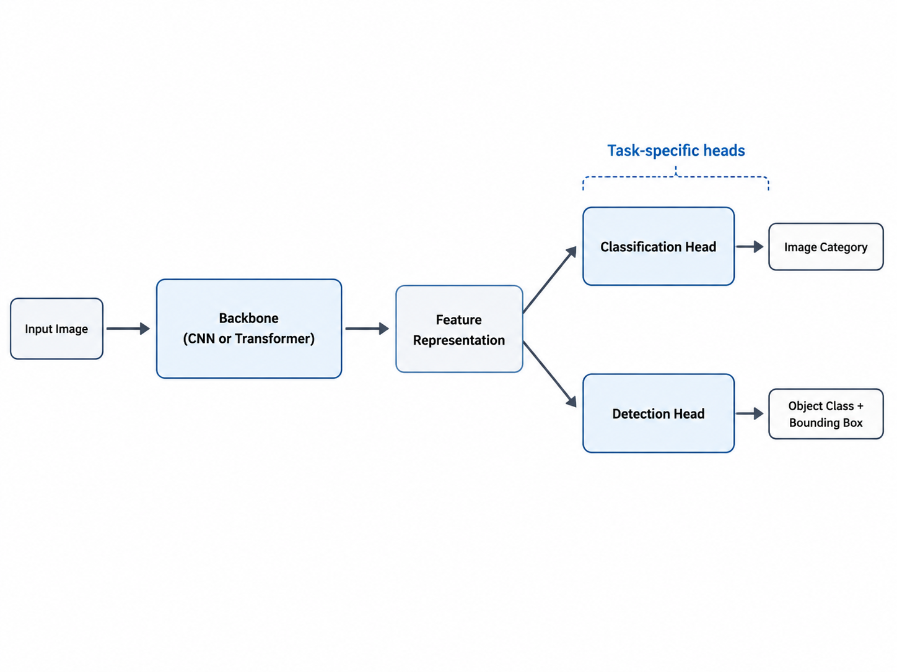{#fig-1-vision-model-diagram fig-align="center" width="400"}

## 2.1 Convolutional-based Vision Models

Convolutional neural networks (CNNs) are one of the most widely used neural network architectures. The development of convolutional neural networks can be traced to biologically inspired models of vision.

A hierarchy model [@Hubel1962] [@Hubel1965] proposed that the neural network in the visual cortex are structured in a hierarchical way: responses from low level cells are integrated by higher-level cells, so that more complex visual features of larger receptive field can be detected with great tolerance to positional shifts. Based on this idea, Fukushima proposed the Neocognitron [@fukushima1980neocognitron], an early neural network model for visual pattern recognition. @fig-neocognitron shows how the Neocognitron structure corresponding to the biological hierarchy visual model. In the Neocognitron, the ($U_s$) and ($U_c$) layers provide an artificial analogy to simple and complex cells. S-cell layers detect local visual feature, while C-cell layers combine nearby responses. A complex visual representation is built by repeating the S-cell followed by C-cell structure.

During training, an input image is represented as a matrix of values, with larger values indicating stronger signals. Different sets of learnable weights are used to produce S-planes, each responding to specific visual features. The responses within each S-plane are then combined to produce a corresponding C-plane. As the signals propagate through all S- and C-layers, simple features are integrated and eventually represented by the responses in the final C-layer.

::: {#fig-neocognitron layout="[[1],[1]]"}
![Correspondence between the hierachy model by Hubel and Wiesel, and the Neognutron [@fukushima1980neocognitron]](chapter0_img/Neocognition-1.png){#fig-neocognitron1 fig-alt="ss"}

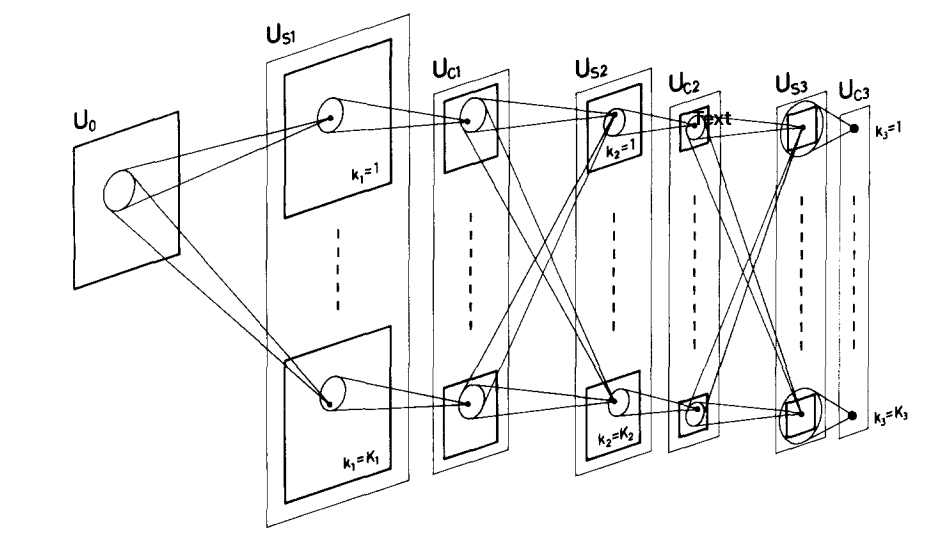{#fig-neocognitron2 fig-align="left" width="329"}

Diagram of interconnecting layers in the neocognitron[@fukushima1980neocognitron]

Neocognitron design is inspired by the visual biological structure
:::

While the Neocognitron is considered as a biologically inspired precursor, it was designed for vision cognition and learned in a unsupervised way. It was evaluated based on consistent distinct responses to different input patterns. It did not consider feature reuse in the design, hence, it could not be used as a general purposed feature extractor (backbone) to combine with downstream tasks.

LeNet [@lecun], proposed by LeCun, represented an early form of modern convolutional neural networks that allows end-to-end training, which is jointly training of a feature extractor and a classifier. <!-- By combining trainable convolutional layers, shared weights, subsampling operations, and supervised learning,  --> LeNet established a basic structure for later CNN architectures, and it enabled image features to be learned directly from image data for reuse. In this structure, convolutional filters (@fig-2-convolution-operation) are applied to local regions of the input image to detect spatial patterns.

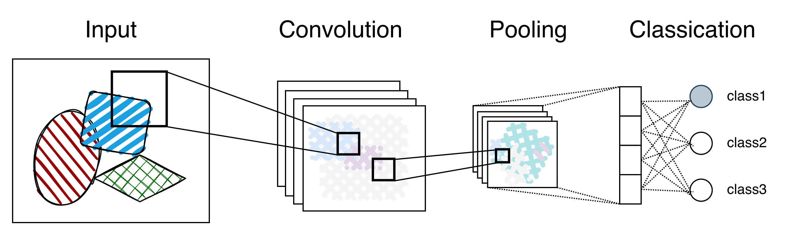{#fig-2-convolution-operation layout="[1]"}

The fundamental operation in CNNs is Convolution. A smaller matrix of learnable weights, named as filter or kernel, slides across the input image, which is represented by matrix of pixel values. During the sliding, it multiplies its weight with the overlapped input pixels and sums them up. The kernel weights are shared across different spatial locations as the kernel computes responses to local visual patterns, producing a feature map that represents the strength of these responses at each location.

As the filter slides across the image, its weight will remain unchanged, these reused parameters are referred to as shared weights. The filter plays a role similar to weights in the Neocognitron, and the feature maps are similar to S-planes.

<!-- in that they respond to local visual patterns and provide the basis for progressively more complex feature representations. -->

Another important operation in CNNs is pooling. Pooling is a downsampling technique that reduces the spatial dimensions of feature maps. This process aggregates local spatial information and provides some tolerance to shifts in feature positions. Pooling is conceptually similar to the integration of information from S-layers to C-layers in the Neocognitron.

As local visual patterns are propagated and integrated through successive layers, simple features such as edges and angles are combined into complex patterns. Unlike these simple features, high-level features extracted by CNNs are often difficult for humans to interpret because they encode complex combinations of visual patterns. These complex visual patterns represented by the feature maps in the final layer are then used as inputs for downstream tasks.

The use of local convolutional filters and shared weights gives CNNs strong image-specific inductive biases. Local convolutional filters implies the assumption that nearby pixels are more likely to be related than distant pixels. Shared weights allow the same filter to be reused across spatial locations, this design supports translation equivariance, in which a spatial shift in the input tends to produce a corresponding shift in the feature response. By stacking multiple convolutional layers, CNNs can gradually integrate local patterns into complex and abstract visual representations. This local-to-global organization is conceptually similar to Neocognitron and related to hierarchical processing in the biological visual system, except the extracted features can be reuse for other tasks.

<!-- Because the same filter is reused across the image, the network can detect similar patterns in different positions while using fewer parameters than a fully connected network. These architectural properties give CNNs strong image-specific inductive biases, which is the assumption that nearby pixels are more likely to be related than distant pixels. The reuse of the same filter across spatial locations also supports translation equivariance, where a spatial shift in the input tends to produce a corresponding shift in the feature response. The staking multiple convolutional layers allows CNNs gradually integrating features in local patterns into more complex and abstract visual representations.  -->

<!-- The properties are believed to have ability of -->

<!-- This local processing is conceptually related to the biological visual system. In the visual cortex, neurons respond to stimuli within limited regions of the visual field in stead of the entire image. Similarly, convolutional filters operate on local image regions and produce responses that indicate where certain visual patterns are present. By stacking -->

<!-- LeNet implemented a trainable network by using convolutional filters, shared weights, and subsampling layers. These components allow CNNs to process images locally at early layers and progressively build more abstract visual features in deeper layers. -->

<!-- The convolution operation is the basic operation in CNNs, as shown in @fig-...  -->

<!-- A convolutional filter, or a kernel, is applied to local regions of the input image. The filter provides a weighted sum within the local region. As the filter moves across the image, it picked up the feature on the image and produce a feature map that represent the strength of the filter response at different spatial locations.  -->

<!-- Because the same filter is reused across the image, the convolution operation uses shared weights. This allows the network to detect the same type of visual pattern in different locations while using fewer parameters than a fully connected structure. -->

<!-- Subsampling layers further support this structure by reducing the spatial resolution of feature maps. These layers summarize local responses and make the representation less sensitive to small changes in object position. Through repeated convolution and subsampling operations, CNNs can gradually transform low-level local patterns into more abstract visual representations. -->

<!-- This design is conceptually related to the biological visual system. In the visual cortex, neurons respond to stimuli within limited regions of the visual field, known as receptive fields. Similarly, convolutional filters operate on local image regions and produce responses that indicate where certain visual patterns are present. The stacking of multiple convolutional and subsampling layers also parallels the hierarchical organization of biological visual processing, where simple local responses are gradually combined into more complex representations. -->

## 2.2 Attention-based Vision Models

Attention-based vision models are another major class of neural network-based models. Attention mechanism is introduced in a natural language processing model named Transformer [@transformer]. The attention mechanism allows a model to assign different weights to different parts of the input. Heavier weights indicate relevant parts contributing more to the learned representation, which directly models global context. This idea was later adapted to vision modeling through the Vision Transformer [@vit] (ViT). The Vision Transformer inherits the attention mechanism to model region relevance. An input image is represented as a sequence of segmented visual patches, and the patches are assigned attention weights according to their relevance to the representation. In this way, the model learns relationships among different patches and captures long-range dependencies across the image. This differs from CNNs, which primarily learn local patterns through convolutional operations and gradually build broader spatial context though stacking layers.

The diagram of feature extraction is shown in @fig-vit. The input image is first split into image patches. These patches are embedded as tokens and then processed by the self-attention module. The self-attention assigns different weights to different patches according to their relevance.The output feature matrix contains the learned feature representations of the image, which are used for classification. The feature matrix incorporates information integrated across image patches through self-attention and serves a role similar to the final feature maps in CNNs, providing learned feature representations for classification.

{#fig-vit}

<!-- Later transformer-based vision models extended the original ViT by introducing more architectural designs such as hierarchical feature maps, local attention, ect.  -->

While CNNs assumes that local regions are more likely to be related by employing local filters, the Vision Transformer does not impose receptive fields and models global context with a direct mechanism. Therefore, the Vision Transformer often requires large-scale training data to learn robust visual representations [@vit].

<!-- 全局建模导致需要更多的数据来做预训练 However, this global modeling ability comes with weaker built-in locality assumptions compared with CNNs, which partly explains why Vision Transformers often benefit from large-scale pretraining. -->

<!-- Transformer-based vision models provide a framework to learn global image representations. However, compared with CNNs, the Vision Transformer has fewer built-in assumptions about local image structure, such as locality and translation-related spatial consistency. As a result, strong performance often depends on large-scale training data or pretraining. Later transformer-based architectures, such as the Swin Transformer, introduced hierarchical feature maps and local window-based attention, making transformer models more suitable for dense prediction tasks, including object detection and segmentation. -->

<!-- Therefore, transformer-based models can also serve as visual backbones for downstream computer vision tasks. Together with CNN-based architectures, they form an important foundation for modern neural network-based vision models. -->

<!-- In addition to convolutional neural networks,, another class of vision neural networks are transformer-based models. -->

<!-- In addition to convolutional neural networks, transformer-based models have become an important class of neural network-based vision models. The Vision Transformer (ViT), introduced by Dosovitskiy et al. (2021), adapted the transformer architecture from natural language processing to image recognition. Instead of applying convolutional filters to local image regions, ViT divides an image into a sequence of fixed-size patches. Each patch is flattened and projected into an embedding vector, and the resulting sequence is processed by transformer layers using self-attention. -->

<!-- The key mechanism in Vision Transformers is self-attention, which allows the model to learn relationships among different image patches. In contrast to CNNs, where local spatial patterns are first captured through convolution and larger structures are gradually formed by stacking layers, Vision Transformers can model interactions between distant image regions more directly. This makes transformer-based models effective for learning global image representations. However, because ViT does not include the same built-in locality and translation-related inductive biases as CNNs, it often requires large-scale training data or pretraining to achieve strong performance. -->

<!-- Vision Transformers provide an alternative approach to visual feature extraction. Like CNNs, they can be used as visual backbones for downstream tasks such as image classification and object detection. Later vision transformer models further improved the original ViT design by introducing hierarchical structures and local attention mechanisms, making them more suitable for dense prediction tasks such as detection and segmentation. -->

## 2.3 Heads and Transfer Learning

Both CNN-based and attention-based architectures can be used to extract complex image features. However, these features must be used by a task-specific head to complete a particular task. For image classification, a classification head maps the features to category predictions. For object detection, detection heads use the feature representation to predict both object categories and locations.

In a specific project, the task-specific head is usually selected or modified according to the objective of the study. For example, in an image classification task with seven categories, the final classification head need to be replaced by a seven-class classifier. The classifier essentially performs a multinomial logistic regression to categorize. The model is then trained by minimizing a task-specific loss function, such as a classification loss for category prediction. The loss used for categorical classification is the cross-entropy loss, which measures the difference between the predicted class probabilities and the ground truth label.

In many applied vision projects, the computing resource or the number of project-specific training images are limited. Therefore, transfer learning is a strategy in the training to improve efficiency and performance. In transfer learning, a model is first pretrained on a large scale dataset, such as ImageNet [@imagenet-transferlearning] for image classification, and then adapted to the target dataset.

Through pretraining, the backbone learns the weights to extract features and present them in a complex way, which is impossible for human to understand. These features are considered transferable across different image datasets and vision tasks [@transfer-learning] because they encode visual patterns and structures shared by visual objects. Then the task-specific head can be replaced or fine-tuned for the new task. The task-specific model is further trained using the target data. During the training, the pretrained backbones can be freezed or fine-tuned together with the new head, because it was found that features in deeper layers become increasingly specific to the original task [@transfer-learning]. The transfer learning diagram is shown in @fig-transfer-learning.

::: {#fig-transfer-learning layout="[1,1]"}
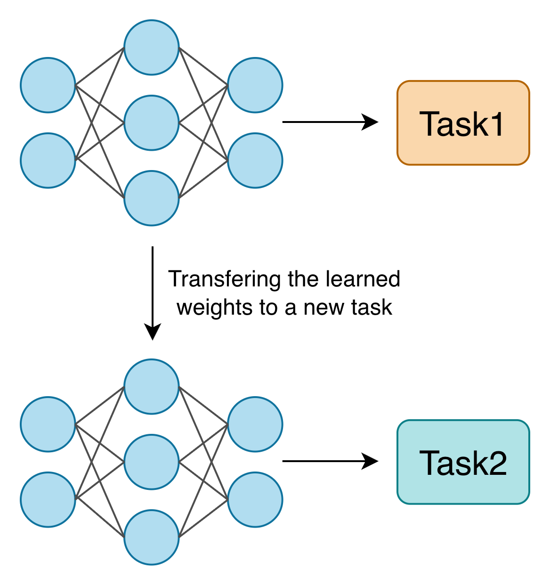{#fig-transferidea width="275"}

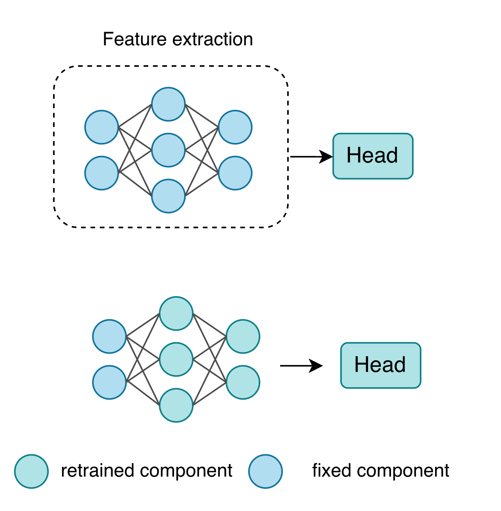{#fig-transfer-training width="282"}
:::

Previous studies have demonstrated that transfer learning is effective, especially across visual network architectures and tasks [@vit] [@R-CNN] [@vgg] [@resnet].

The goal of the present study is to locate and classify footwear class characteristics. These characteristics often consist of geometric patterns that contain both local features and broader spatial context. For example, recognizing a circular pattern requires the model to identify local curvature as well as the overall closed shape. Therefore, both CNN-based and attention-based models are considered suitable for this task. Given the limited amount of labeled training data, transfer learning is employed to improve model performance.

# 3 Image Classification

Image classification is a fundamental task in computer vision because it provides a basic framework for learning and evaluating visual feature representations. A classification dataset consists of images and their corresponding class labels, which are assigned to the entire image. In a classification model, a classification head uses these features that output from a backbone to predict the image category. Many widely used backbones were originally developed and evaluated on image classification datasets. The representations learned through classification later became the foundation for models used in various vision tasks. This section reviews four representative architectures: AlexNet [@alexnet], VGG [@vgg], ResNet [@resnet], and the Vision Transformer [@vit]. These architectures illustrate important developments in convolutional and attention-based visual modeling.

## 3.1 Data

An image classification dataset consists of images and their labels. In the simplest case of single label task, each image is assigned to one category. The labeled images are divided into training, validation, and test sets. The training set is used to optimize the model parameters by minimizing a classification loss function, which measures the difference between the predicted class and observed labels. The validation set is used to identify potential overfitting, and the test set consists of held out images which are reserved for the final evaluation. During training, both the backbone and the classification head can be optimized: the backbone learns visual feature representations, and the classification head maps these features to class predictions.

## 3.2 Architectures

### 3.2.1 AlexNet

<!-- Image classification is also important because it has served as a major source of pretrained visual backbones. Models trained on large-scale classification datasets can learn general visual representations, which can later be transferred to more specialized tasks. Therefore, reviewing image classification provides a useful basis for discussing backbone architectures, transfer learning, and their later use in object detection. -->

AlexNet, introduced by Krizhevsky [@alexnet], is an influential convolutional neural network. It demonstrated that a large convolutional network could be successfully trained on a large-scale image dataset, and hierarchical visual features could be learned directly from image data.

The success helps to establish deep CNNs as a central approach in computer vision. Its architecture incorporated several techniques that facilitated large-scale CNN training to allow effective robust feature representation learning and large scale image classification.

<!-- which sets all negative values to zero while keeping positive values unchanged. This design introduces non-linearity, which enlarges the output space compare to solely linear combination. Hence, the model can learn more complex patterns. The threshold operation also improves computational efficiency. -->

<!-- 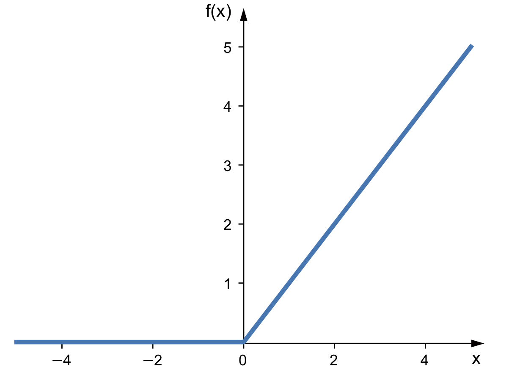{#fig-relu height="200"} -->

<!-- Dropout is a regularization technique used to reduce overfitting. During training, it randomly “drops” (i.e., temporarily deactivates) a proportion of neurons in the network. This forces the model to learn more robust and distributed feature representations rather than relying too heavily on specific neurons. -->

Although transfer learning had been studied earlier than AlexNet, the success of AlexNet contributed to the prevalence of transfer learning. Fine-tuning a deep neural network initialized with pretrained weights, such as those from AlexNet, has been shown to outperform training the same network from random initialization [@transfer-learning]. Transfer learning with networks pretrained on large-scale datasets therefore provides a general paradigm for various vision-related tasks.

Another practice popularized by AlexNet was data augmentation. Data augmentation artificially enlarges the training dataset using label-preserving transformations, which helps the network learn more general features and reduces overfitting. AlexNet applied several augmentation techniques (@fig-augmentation), including random cropping, horizontal reflection, and RGB intensity perturbation. These operations do not change the semantic content of the image but expose the model to different variations of the same object, improving its ability to generalize to unseen data.

![Data augmentation [@deng2009imagenet]](chapter0_img/augmentation_.png){#fig-augmentation height="200"}

### 3.2.2 VGG

Building on the success of AlexNet, deeper networks was proposed to improve feature learning, representatives of the deep networks are the configurations proposed by Simonyan et al. [@vgg]. These configurations became widely know as VGG networks, named after the Visual Geometry Group at the University of Oxford. The two commonly known architectures are VGG-16 and VGG-19, which use a simple and uniform design based on repeated small convolutional filters (3 by 3) and contain 16 and 19 learnable layers, respectively. Compared with AlexNet, which contains eight learnable layers (five convolutional layers and three fully connected layers in the head), VGG substantially increased network depth, see @fig-layer_diff. The study demonstrated that this deeper architecture improved image classification performance, suggesting an improved ability to learn discriminative visual representations.

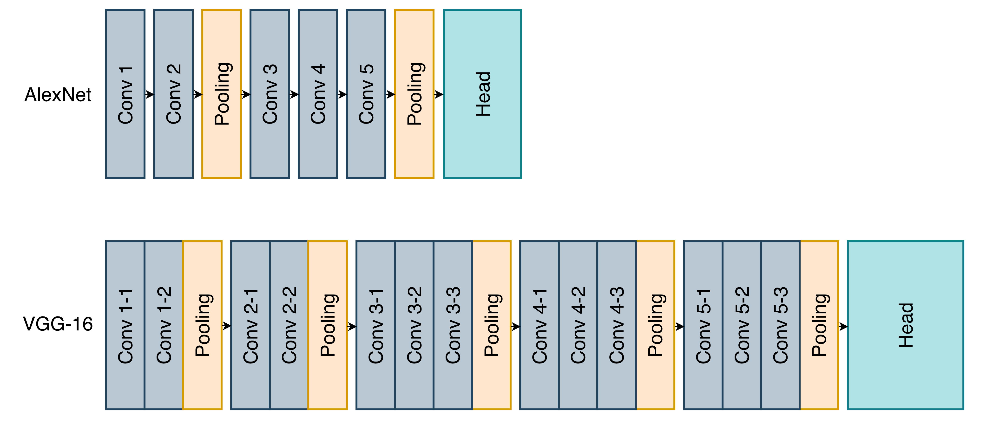{#fig-layer_diff height="200"}

### 3.2.3 ResNet

The deep layer design of CNNs brought an unexpected degradation despite better performance. It was found that adding more identical layers could result in higher training error as well as test error [@layerdiff]. This observation suggests that the performance degradation is primarily associated with optimization difficulties rather than overfitting.

ResNet architectures [@resnet] addressed the problem by introducing a deep residual learning module. This module adds a shortcut connection to add the input directly to the output of a few layers. The design makes optimization easier by learning the residual modification relative to the input rather than the full mapping. If the modification is small, as in an identity mapping, the optimization becomes much easier than in the normal design (@fig-residual).

ResNet networks has five standard variants, ResNet-18, ResNet-34, ResNet-50, ResNet-101, and ResNet-152. Although ResNet-18 is the shallowest variant, it still has 18 learnable layers, which is deeper than the VGG-16 (@fig-difflayer3). ResNet achieved improved image classification performance while enabling much deeper networks to be trained effectively.

::: {#fig-classification-all layout="[1,1]"}
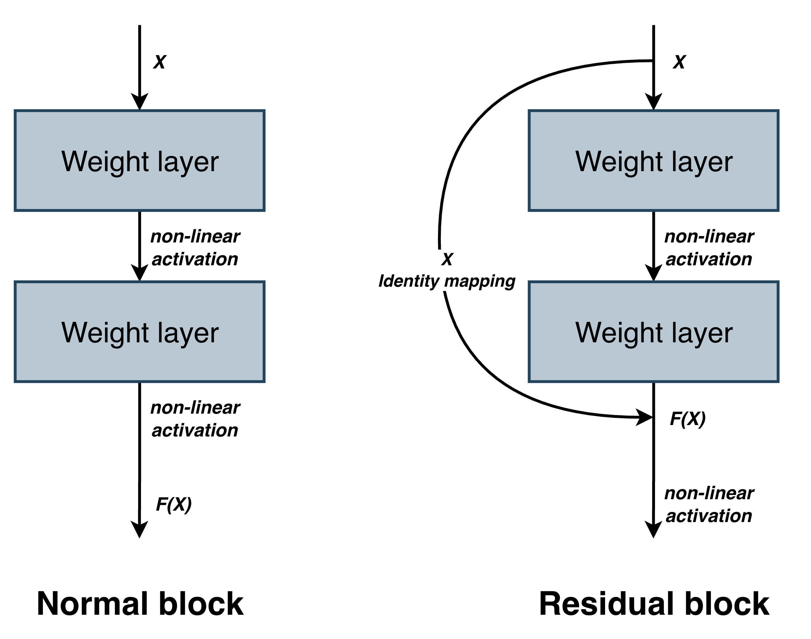{#fig-residual height="200"}

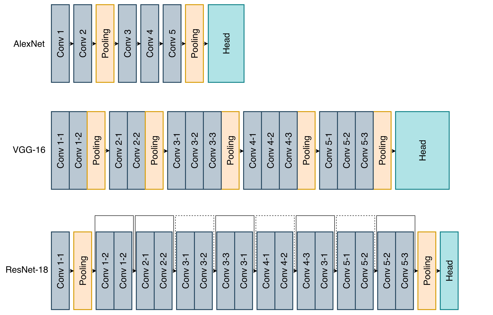{#fig-difflayer3 height="200"}
:::

### 3.2.4 ViT

While CNNs rely primarily on local convolutional operations to extract visual features, the Vision Transforner (ViT [@vit]) introduced a different approach that captures global dependencies across an image. Attention weights are learned to represent relationships among image patches. Unlike CNNs, which have inductive biases such as locality and translation equivariance built into the architectures, ViT uses global self-attention and imposes relatively little two-dimensional neighborhood structure. Therefore, ViT performance can be more sensitive to the amount of project-specific data。

<!-- https://www.lightly.ai/blog/vision-transformers-vit -->

These architectures were initially proposed as classification models, which includes feature extraction and class prediction. The major architectural difference lie in the feature extraction designs (backbone) rather than the classification heads. The classification heads serve a similar role to map extracted features to class predictions.

Since backbone reflects the main architectual characteristics of models designed for the same task, architecture names are commonly used to describe the unique underlying feature extraction design when these models are adapted as backbones for other tasks. For example, the same detection framework can be implemented with different backbones, such as VGG or ResNet, and these variants are often referred to by their backbone architectures.

To identify footwear characteristics, extracting the characteristics is an essential piece of the task. Since the available representative backbones options for visual feature learning, it worth to evaluate the networks performances in extracting and classifying footwear characteristics.

# 4 CNN-based Object Detection

Classification is not sufficient to complete the goal of the present study. Footwear characteristics must be both localized and classified to automate the process. Therefore, the task is formulated as an object detection problem rather than an image classification problem.

## 4.1 Object Detection Designs

In the detection workflow, the input image is first processed by a visual backbone to extract feature representations. A detection head then uses these representations to locate and classify target patterns. <!-- The detection head converts the learned features into task-specific outputs, commonly including bounding box coordinates and class scores. The bounding box represents the predicted spatial location of an object or region of interest (RoI) within the image, while the score indicates the likelihood that the detected object belongs to a particular category. --> Object detection models can be broadly categorized into two-stage and one-stage models. <!-- , and more recent transformer-based approaches.  --> Two-stage detectors first generate candidate regions that may contain objects and then classify and refine these regions, multiple networks are trained at the same time. Faster R-CNN is a representative two-stage detector (@fig-detections upper panel). In contrast, one-stage detectors predict object locations and class labels directly from image features without a separate region proposal stage (@fig-detections lower panel). YOLO models are representative examples of this approach.

<!-- @fig-detections shows a diagram of the two detector types.  -->

<!-- The one-stage detector is shown in the upper panel, it directly predicts object categories and locations from image features without a separate region proposal stage. However, the two-stage detector that is shown in the lower panel includes a Region Proposal Network (RPN) to generate candidate regions. These regions are then processed by the second-stage detection head, which performs classification and bounding-box regression in parallel to refine the proposed region.  -->

One-stage detectors simplified the architecture by excluding the additional region proposal stage, this design reduces computational cost and enables faster inference, making them suitable for real-time applications. However, without a separate proposal and refinement process, one-stage detectors may have relatively lower localization accuracy compared with two-stage detectors. The present study does not require real-time detection and prioritizes accurate localization, Faster R-CNN was selected as the detector.

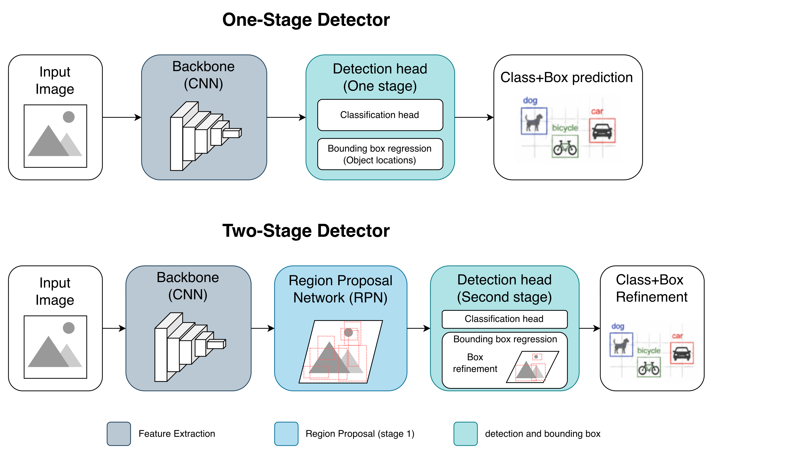{#fig-detections height="200"}

<!-- --------------- should I include this?  -------------------- -->

<!-- More recently, transformer-based detectors have been introduced for object detection. For example, DETR formulates object detection as a direct set prediction problem and uses attention mechanisms to model relationships among image regions. These approaches differ from traditional CNN-based detectors in how they represent spatial relationships and generate predictions. -->

<!-- ----------------------------------------------------------- -->

## 4.2 Faster R-CNN Backbones and Heads

Faster R-CNN framework consisting of a backbone, a Region Proposal Network (RPN), and a second-stage detection head. The backbone is responsible for converting the input image into feature representations that retain visual and spatial information in the image. Based on the information, the RPN generates candidate regions that possibly contain the objects. The candidate regions will be send into the detection head. The detection head has two parallel branches: a classifier that predicts categories for the regions, and a regressor that adjusts the coordinates of the proposed box.

Faster R-CNN implementations can be realized by changing the backbone while the overall framework remains unchanged. As mentioned previously, backbone designs fundamentally affect the feature representations provided to the detector, and consequently, detection performance. Different backbone designs can provide different levels of semantic abstraction and retained spatial information [@FPN]. The retained spatial resolution is particularly important for localization because it determines how much positional detail is preserved.

<!-- In the first stage, a backbone network extracts feature maps from the input image, and a Region Proposal Network uses these feature maps to generate candidate regions that may contain objects or regions of interest. In the second stage, the proposed regions are passed to a detection head, which assigns class labels and refines the bounding box locations. The proposal-and-refinement structure improves performance of localization. Candidate regions proposed in stage one will be refined in the second stage, which allows the model to adjust initial predictions toward more accurate target locations. The unified framework improves efficiency of the pipeline, as the backbone and detection head can be trained jointly. -->

## 4.3 Data

Object detection has a different data structure than the classification task. To obtain the ability of predicting spatial location, the training data must provide positional information in addition to the class label. Input images are paired with these human-provided annotations, which serve as the ground truth that guides model training and evaluation. For example, in @fig-2-detection-data, the image is annotated with both bounding boxes to indicate spatial locations as well as class labels for objects in the bounding boxes. An individual object detection image allows multiple target instances, each instance associates with a class label and a spatial annotation. The annotated regions can belong to the different classes, and it is common to find them overlap.

![Object detection data [@deng2009imagenet]](chapter0_img/detection-data.png){#fig-2-detection-data width="289"}

Low quality input would limit the network performance, hence, annotation quality is an important consideration in object detection. Previous studies have shown that small discrepancies in location annotation, such as different box sizes, and noisy can influence localization performance, especially for small objects [@annotatesize] because its susceptibility to errors. In addition, deviation from intended localization has been shown to reduce the detection performance of Faster R-CNN [@noisyannotation].

<!-- Despite these architectural differences, these models share the same general objective: to locate target regions and assign them to appropriate categories. Therefore, when detection performance is limited, the source of difficulty may come from localization, classification, or both. This connection is important for the present dissertation, which examines classification as a controlled setting for understanding conditions that may limit neural network-based footwear impression analysis. -->

<!-- Although these models differ in architecture, they are commonly trained to minimize errors in both class prediction and object localization. -->

<!-- ## 4.2 Difference Between Classification and Object Detection  -->

<!-- A classification task can share identical backbone with pretrained wights, but the detection task requires additional  -->

<!-- ### 4.1.1 Data Structure -->

<!-- ### 4.1.2 Head -->

<!-- ### -->

<!-- Mainly focus on how detection tasks build on classification tasks -->

<!-- ## 4.2 Data Structure for Object Detection  -->

<!-- Talk about the data structure, especially annotating with bbox, which will be mentioned in the section 5 -->

<!-- ## 4.3 Backbone and Detection Head  (Not sure, because detection head is mostly irrelavent to this discussion) -->

<!-- ## 4.4 Fast R-CNN family (Not sure if I should mention YOLO and details because no architecture details will be mentioned) -->

<!-- ## 4.4.1 ? Faster R-CNN  -->

<!-- All are too detailed to be included -->

<!-- ?Region Proposal Network  -->

<!-- ?Proposal Classification and Bounding Box Regression  -->

<!-- ?Advantages of the Proposal-and-Refinement Framework -->

<!-- # 5 How Human Making Judgement -->

<!-- An automated networks is -->

<!-- Human observes and perceives visual inputs by summing up localized features, but more than summation of localized features. -->

<!-- ## 5.1 Human hierarchical visual processing -->

<!-- ## 5.2 Gestalt Principles -->

<!-- ## 5.3  -->

# 5 Relevance to the Present Study

<!-- # 2 Object Detection -->

The footwear feature automation can be framed as an object detection task that consists of two main stages: first locating footwear class characteristics or patterns, and classifying the detected regions. However, approaching the problem is more than adapting the network architecture.

## 5.1 Challenge

Object detection requires precisely annotated training data so that the network can learn both spatial and categorical information. Previous studies have reported that degraded annotation quality can significantly reduce detection performance [@annotatesize; @noisyannotation]. Therefore, annotation quality is an important factor in network performance.

Unlike general-purpose pretraining datasets, where object classes are typically clearly defined, footwear features can be more complex and ambiguous. For example, @fig-brokencircle shows a feature coded as a “circle” in the forensic footwear tool SoleMate. However, the feature itself consists of four individual arcs. It is therefore open to discussion whether this feature should be annotated as four separate regions labeled as arcs or as one bounding region labeled as a circle, taking into consideration a higher-level grouping effect.

In addition to this ambiguity in grouping individual elements, uncertainty can also arise from unclear boundaries between feature categories. For example, @fig-oval and @fig-roundedbar are coded as “oval” and “bar with rounded ends,” respectively, and belong to two different categories. However, the perceptual boundary between these categories may become unclear as the shape is progressively elongated or compressed.

It is also difficult to exhaustively represent all possible feature variants when the labeling system is restricted to a limited set of basic categories such as circles, bars, and polygons. For example, @fig-knobbly represents a variant of a circle. Numerous visually different features may still be coded within the same “circle” category, making it impractical to collect examples of every possible variant for model training.

::: {#fig-isolatedsameshape layout-ncol="4" layout="[1,1,1,1]"}
{#fig-brokencircle}

{#fig-oval}

{#fig-roundedbar}

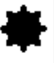{#fig-knobbly}
:::

## 5.2 How Human Makes Judgement

A closer examination of the labeling process suggests that object classes should be defined according to common human visual perception. The trained network is intended to assist footwear examiners, hence, consistency between human interpretation and network labels is important. For this reason, the classification labels should align with human cognition in this study.

A ventral pathway is a pathway that process information that leads to recognition and identification of objects. Visual information is processed hierarchically along the ventral visual pathway. When human sees an object, the eye-seeing signals first reach V1 area, where basic features such as edges, orientations, and contrast are detected. These signals then travel through the nervous system, they are reorganized in a way so that they are received as an objects eventually. The hierarchical pathway looks similar to the model that inspired Neocognitron, however, there could be differences between how the signals are eventually reorganized and interpreted by a neural network model and human.

The principles of perceptual organization proposed by Gestalt psychologists explain how and why human makes judgement by organizing visual information. According to Gestalt principle of relatability [@relatability] and closure [@gestalt], the broken circle (@fig-brokencircle) is perceived as a circle because the curvatures are compatible, consequently the missing contour can be interpolated and integrated into a continuous contour, and is perceived as a circle. Even larger gap can be filled that a non-existing object is perceived, the most famous example is the Kanizsa triangle [@kanizsa] (@fig-Kanizsa). In @fig-Kanizsa, although a triangle whose edges are not physically present, human perceives the boarder of a invisible triangle from the incomplete shapes.

<!-- Then the information is passed to V2 area, where simple features are combined into more complex patterns and contours.  --> <!-- The information continues progressing to higher level regions where representations becoming increasingly associated with complex shape and object.  -->

<!-- Although it looks like a one-directional process, the areas are communicating in both ways, which makes perception a product of Bottom-up process and Top down process. The Bottom-up process is driven by sensory information while the Top-down process is driven by prior knowledge.  -->

<!-- In the Bottom-up process, l -->

<!-- After local features of objects like spots and edges are collected,  -->

{#fig-Kanizsa width="169"}

<!-- Neuroscientific studies suggests that there are the connected neurons in the primary cortex area (V1 area) compare their input, and they respond to illusory edges in a similar way of responding to a real line. -->

<!-- light energy of objects are converted into electrochemical signals by photoreceptor cells, the signal strength depends on the light intensity. There are hundred millions of photoreceptors, so not all signals are treated equally when they travel through the neurvous system. The visual system selectively integrates signal from particular regions to form receptive fields, where uniform information tends to be suppressed, while local contrast is emphasized. The visual system collect information from the  -->

In addition to the coherent perception, human also weighs global contour organization and local features in the judgement. Loffler et al. [@loffler2003local] and Wilkinson et al. [@wilkinson1998detection] studied smooth wave-like deformations of circles (radial frequency change @fig-RF1 @fig-RF2). They found observers can detect very small shape changes, but when the contour is disrupted or rearranged, performance drops strongly. Wilson [@wilson2015detection] studied controlled deformations that gradually transform circles into polygons (angular frequency change, @fig-AF1 @fig-AF2), they found jittering the contour has little effect, and performance on single angle is close to performance on whole shape. Hence, curved shapes rely more on global contour integration, whereas shapes with corners rely more on local angle information. Weights of global and local information are assigned differently for integration depending on shape type when perceiving a shape.

::: {#fig-geometric layout-ncol="4"}
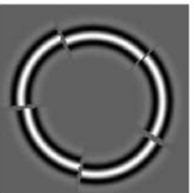{#fig-RF1}

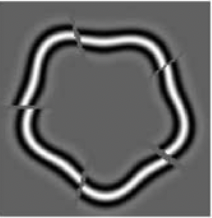{#fig-RF2}

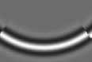{#fig-AF1}

{#fig-AF2}

 Radial and angular deformations [@wilkinson1998detection] [@wilson2015detection]\
*(a)-(b) jittering impairs discrimination suggesting RF (radial frequency) perception depends n glnju9 obal contour arrangements*\
*(c)-(d) single angle has little effect on discrimination suggesting AF (angular frequency) relies more on local features*
:::

Although the CNN designs and ViT designs appear to reflect aspects of how human integrates visual information, whether these models develop similar ability remains an open question.

## 5.3 How the Problem Will be Processed

Although visual networks have been developed for various purposes, their ability to recognize footwear features has not been thoroughly investigated. Footwear features present a particular challenge because many of them can be represented as basic geometric elements, while human perception of these elements is not always determined by strict geometric definitions. Beyond that, the allocation of importance to different features and the principles of perceptual grouping add further complexity to this question. The judgement of classes would introduce additional difficulty of localizing objects because disrupted circle requires a single larger bounding box rather than four smaller bounding boxes. For the resaon stated, this task is different from common transfer-learning applications.

The goal of this study is to align network judgments with human judgments, making it important to explore the abilities and potential of neural networks. CNNs and ViT architectures share some similarities with human visual information processing. CNNs incorporate several principles inspired by biological visual processing, while attention-based models focuses on attributing attention to more relevant features cross image regions. Although this is not a direct model of human attention, the adaptive weighting of relevant information is conceptually related to selective attention in the human visual system. However, whether these designs enable neural networks to make judgments similar to those of humans remains an open question. Therefore, we examine the performance of neural networks in image classification and object detection tasks, and evaluate whether they can recognize geometric footwear features in a manner consistent with human perception. Specifically, we investigate their ability to extract basic geometric elements, the effects of backbone depth and architectural characteristics on feature representation, and whether networks trained on predefined shape categories can recognize and classify shapes formed through Gestalt perceptual organization.

<!-- Annotating features by the smallest isolated shapes would not work. @fig- is an example, it is intuitive for human to recognize the circle, the shape is essentially a broken circle, or four arcs. Annotating by arcs instead of a circle would fail the network from learning the Gestalt principle, if it can . -->

<!-- SoleMate, a forensic tool, uses isolated features for coding shapes, @fig- is categorized as round. Although  -->

<!-- For example, Gestalt principles suggest that local element are organized through global configuration. Fig-brokencircle is an Broken circle, which can also be described as arcs. -->

<!-- Another example is that human observers categorize by perceptually similarity. Regular polygons with increasing numbers of sides progressively approximate circular contours, so a 18-sided regular polygons is perceived as a circle (@Fig-).  -->

<!-- Forensic tools like SoleMate would build a database that isolates basic features like circle, polygons etc.  -->

<!-- Making judgment similar to human requires the network weighting global and local information.  -->

<!-- rather than relying only on strict mathematical definitions, otherwise, the network results can be misleading in practical examination. -->

<!-- The challenge is more difficult when considering how human organizing multiple visual inputs. Human processes visual stimuli more than summation of localized features. Gestalt principles suggest that local element are organized through global configuration.  -->

<!-- Human observers perceive visual inputs more than summation of localized features. Gestalt principles suggest that local element are organized through global configuration. The orga- nization impacts shape judgments, for instance, Figure 1a is an example of an illusory white square emerging with four pacmen. Human tends to complete the disc sectors as complete discs to organize the illusory figure. However, the illusory is less strong in Figure 1a where pacmen are replaced by crosses, despite similar local edges remain. Another example is shown in Figure 1b, where rounded squares are identified as isolated objects in (right), but consid- ered as two overlaying bars when they connect at corners. The small alternation of contours induces perceptual re-organization, so that different shapes are perceived in images. -->

<!-- Explanations for these findings are not limited to psychological-level, they can be explained at neural-level. Neuron experiments suggests that early cortex area, V1, encodes local physical features, while higher area, V2, organizes the features into contours, surfaces, and figure-ground relationships2 34. In addition, attention can further select one organized interpretation than another5 6. Figure 1a shows that the illusory interpretation only emerges in the left figure because it is supported by global organization. Figure 1b further illustrates that local the -->

<!-- 1 -->

<!--   (b) isolate squares Figure 1 Small local changes result in extensive perceptual judgement1 -->

<!-- assignment of local edges to objects can depend on global organization and can be modulated by attention. -->

<!-- Weighting of global and local information is also observed in judgement of simple geometric shapes. Studies on geometric shape perturbation have shown that human perception of geo- metric shapes depend on both global contour organization and local features. Loffler et al.7 and Wilkinson et al.8 studied smooth wave-like deformations of circles (radial frequency change Figure 2a Figure 2b). They found observers can detect very small shape changes, but when the contour is disrupted or rearranged, performance drops strongly. Wilson9 studied controlled deformations that gradually transform circles into polygons (angular frequency change, Fig- ure 2c Figure 2d), they found jittering the contour has little effect, and performance on single angle is close to performance on whole shape. Hence, curved shapes rely more on global con- tour integration, whereas shapes with corners rely more on local angle information. Weights of global and local information are assigned differently for integration depending on shape type when perceiving a shape. -->

<!-- Neural models are also posited to explain these findings. Detecting radial frequency deforma- tion is believed to relate to hierarchical process. Specifically, V1 detects local orientations, V2 represents curvature, and V4, which is an even higher visual area, pools these signals into a global curved-shape representation. Detecting radial frequency deformation relies more on local cues, which is believed to relate to angle-sensitive neurons in V2. -->

<!-- We need data label -->

<!-- In some forensic tools footwear patterns are coded as isolated basic features, such as round, bars, zigzags ect. Although it seems the basic features are sufficient for shape description, they  -->

<!-- ::: {#fig-isolatedsameshape layout="[[1],[1]]"} -->

<!-- {#fig-isolatedsampeshape1} -->

<!-- 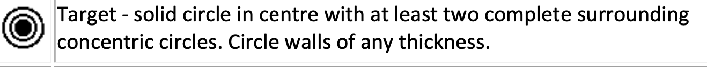{#fig-isolatedsampeshape2} -->

<!-- ::: -->

<!-- Another potential issue with isolated basic feature is the ambiguity between two features, as much as they are thought to be different. For instance, @fig- shows two similar shapes that are categorized in to round and bar. The shape ambiguity is more lies into human capability of discriminating the shapes. Human perceives visual inputs more than summation of localized features. -->

<!-- #### 5.1.1.1 Objective Footwear Feature Classification -->

<!-- The difficulty lies in the ambiguity of footwear shapes. -->

<!-- #### 5.1.1.2 Huamn cognition -->

<!-- #### 5.1.1.3 Spatial annotation -->

<!-- ### 5.1.2 Network Challenge -->

<!-- Networks do not extract features identically, depth and design matter, backbones... -->

<!-- ## 5.2 How the problems will be proceed -->

<!-- ### 5.2.1 Test the networks capability of differentiating shapes, like side20 vs circle -->

<!-- ### 5.2.2 Investigate how their capabilites are affected: shape length change/ angle change -->

<!-- ### 5.2.3 Detection -->

<!-- This is actually the earliest experiment, not sure if I should put it here or bring it to 5.2.1 -->

<!-- 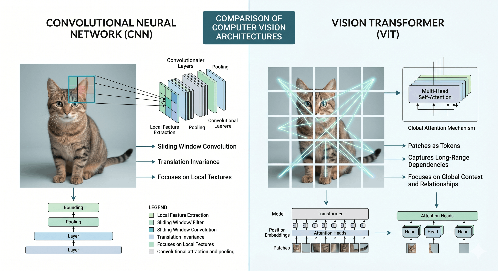{#fig-cnn_vit height="200"} -->

\newpage

# 6 Reference

<!-- ### 2.2.1 Overview of Backbones -->

<!-- Backbone is the a critical factor in detection performance, as it controls the quality of feature representations available to the detection heads. -->

<!-- transfer learning!!!!!!!!!!!! -->

<!-- ### 2.2.2 head -->

<!-- Common backbone architectures in modern vision models include convolutional neural networks and vision transformers. -->

<!-- backbone有哪两类 detection如何在classification上进化 classification如何重要并实现 怎么evaluateclassification -->

<!-- Because object detection requires both localization and classification, the ability to learn discriminative features for classification is important for detection performance. If a model cannot reliably distinguish relevant visual categories, its detection performance may also be limited. -->
